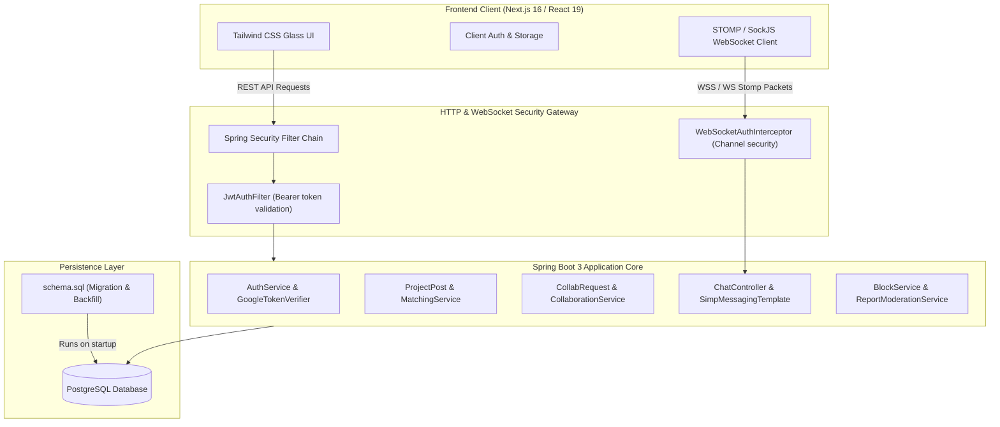

# Huddle

Huddle is a campus-focused collaboration platform for students to share project ideas, match with complementary teammates based on verified skills and availability, coordinate via structured collaboration requests, and communicate through real-time chat and workspace channels.

The project is structured as a full-stack mono-repository consisting of a **Next.js 16 (Turbopack)** frontend, a **Spring Boot 3 (Java 17)** backend with Spring Security and WebSocket (STOMP), and a **PostgreSQL** relational database.

---

## 1. Overview & Problem Statement

### What it is
A campus-gated team-formation and project management workspace where university students connect to build academic and side projects.

### The Problem
University students often find it challenging to assemble multidisciplinary project teams. Existing avenues (informal chat groups, message boards) lack trust verification, clear skill matching, tiered pitch visibility, structured request workflows, or dedicated project workspace channels.

### The Solution
Huddle provides a unified, trusted platform featuring:
- **Two-tier verification**: Mailbox email confirmation combined with campus institutional domain checks (`VERIFIED` vs `PENDING`).
- **Explainable matchmaking**: Skill complementarity and availability overlap ranking for both projects and candidates.
- **Controlled disclosure**: Public project summaries with gated access to full technical specs upon collaboration approval.
- **Lifecycle collaborations**: Transitioning accepted 1-on-1 requests into multi-member project workspaces with live group chat.
- **Safety & Moderation**: Bidirectional blocking and administrative reporting/moderation workflows.

---

## 2. System Architecture



---

## 3. Technology Stack

### Backend
- **Framework**: Spring Boot 3.3.2 (Java 17)
- **Security**: Spring Security 6 (Stateless JWT token filter, BCrypt password hashing)
- **Database / ORM**: PostgreSQL, Spring Data JPA / Hibernate 6
- **Real-Time Messaging**: Spring WebSocket with STOMP message broker (`/topic`, `/app`)
- **Third-Party Integrations**: Google API Client (`GoogleIdTokenVerifier`), Jakarta Mail / JavaMailSender
- **Build Tool**: Maven

### Frontend
- **Framework**: Next.js 16.3.3 (App Router with Turbopack)
- **Core Library**: React 19, TypeScript
- **Styling**: Tailwind CSS 4, Custom "Black Glass" theme, Lucide React icons
- **Protocols**: REST API (`fetch`), WebSocket STOMP (`@stomp/stompjs`, `sockjs-client`)
- **Authentication**: Client-side token management (`localStorage`), Google Identity Services (GSI)

---

## 4. Key Features & Implementation Status

| Feature Area | Implementation Status | Technical Details |
|---|---|---|
| **Email/Password Auth** | Implemented | BCrypt hashing, JWT issuance (24h expiration), password invalidation tracking (`password_changed_at`). |
| **Email Verification** | Implemented | Cryptographically secure SHA-256 token hashing, 24-hour expiry, single-use enforcement, anti-spam resend cooldown. |
| **Password Reset** | Implemented | Secure single-use token links, 1-hour expiry, unauthenticated anti-enumeration responses, immediate session invalidation. Supports passwordless Google accounts establishing their first password. |
| **Google Sign-In & Linking** | Implemented | Google Identity Services integration, audience and signature validation via `GoogleTokenVerifierService`, explicit password challenge for existing email accounts (`/api/auth/google/link`). |
| **Institution Trust Layer** | Implemented | Configurable allowlist (`app.allowed-email-domains`). Automatically grants `VERIFIED` status to allowed domains; other domains register as `PENDING`. |
| **Access Authorization** | Implemented | Unverified or `PENDING` accounts can browse and view public content, but are blocked from posting, requesting collaborations, or sending messages. |
| **Project Posts & Discovery** | Implemented | Tiered visibility (brief description public, full description protected), keyword search across title/skills, multi-attribute filtering. |
| **Weighted Matching Engine** | Implemented | Multi-attribute scoring: 70% Skill Complementarity, 30% Availability Overlap. Supports both project-to-user and post-to-candidate matching. |
| **Collaboration Workflows** | Implemented | Structured request lifecycle (`PENDING` -> `ACCEPTED`, `REJECTED`, `WITHDRAWN`). Transition to multi-member team workspaces. |
| **Real-Time Messaging** | Implemented | WebSocket STOMP chat per collaboration request and per multi-member collaboration workspace. Unread count tracking. |
| **Safety & Moderation** | Implemented | Bidirectional user blocking (posts hidden, requests and chat blocked). User and project reporting endpoints with admin resolution queue. |
| **Admin Tools** | Implemented | Dedicated `/api/admin/institutions` and `/api/admin/reports` endpoints guarded by `ROLE_ADMIN`. |

---

## 5. How Matching Works

The backend provides an explainable matchmaking engine implemented in `MatchingService.java`. It can rank open projects for a student candidate or rank candidates for a project owner:

$$\text{Composite Score} = (0.7 \times \text{Skill Score}) + (0.3 \times \text{Availability Score})$$

1. **Skill Complementarity (70% weight)**:
   - Matches the student's normalized skills against the project's desired skill set.
   - $\text{Skill Score} = \frac{|\text{Desired Skills} \cap \text{Candidate Skills}|}{|\text{Desired Skills}|}$.
   - **Hard Filter**: If $\text{Skill Score} = 0$, the composite score is immediately forced to $0.0$, excluding irrelevant projects.
2. **Availability Overlap (30% weight)**:
   - Checks for set intersection between candidate availability slots (e.g. `weekdays`, `weekends`, `flexible`) and the project's required schedule.
   - Evaluates to $1.0$ if at least one slot overlaps, $0.0$ otherwise.
3. **Privacy & Exclusion Guards**:
   - The user's own projects are excluded.
   - Posts from or candidates belonging to mutually blocked relationships are stripped before scoring.
   - Matched candidate enumeration is restricted strictly to the post creator.

---

## 6. Authentication & Institution Trust Model

Huddle enforces a strict separation between **mailbox ownership** and **educational institution eligibility**:

```
[ Signup / Registration ]
         │
         ├──► Mailbox Verification: Pending (Single-use 24h verification link)
         │
         └──► Institution Domain Check:
                   ├─ Domain matches allowlist (e.g., cityengineeringcollege.ac.in) ──► VERIFIED
                   └─ Domain unknown / non-whitelisted ──────────────────────────────► PENDING
```

- **Mailbox Verification**: Prevents account spoofing. Unverified accounts cannot log in via password credentials until confirmed via `/verify-email`.
- **Institution Status**:
  - `VERIFIED`: Granted immediately to allowlisted domains or manually approved by an admin. Grants full creation, requesting, and communication rights.
  - `PENDING`: Non-allowlisted domains. Users can log in, edit their profile, and browse public projects, but are restricted from mutating actions.
  - `REJECTED`: Accounts denied institution access.

---

## 7. Project Structure

```
huddle/
├── .gitignore                      # Root Git exclusion rules
├── README.md                       # Canonical project documentation
├── huddle-backend/
│   ├── pom.xml                     # Maven build and dependencies
│   ├── dev-run.ps1                 # Local developer startup helper script
│   ├── .env.example                # Safe environment variable template
│   └── src/
│       ├── main/
│       │   ├── java/com/huddle/backend/
│       │   │   ├── config/         # SecurityConfig, BackfillRunner, WebSocketConfig
│       │   │   ├── controller/     # Auth, User, Post, Collaboration, Admin, Chat controllers
│       │   │   ├── dto/            # Request/Response payloads
│       │   │   ├── model/          # JPA Entities (User, ProjectPost, Collaboration, etc.)
│       │   │   ├── repository/     # Spring Data JPA repositories
│       │   │   ├── security/       # JwtService, JwtAuthFilter, WebSocketAuthInterceptor
│       │   │   └── service/        # AuthService, MatchingService, SmtpEmailService, etc.
│       │   └── resources/
│       │       ├── application.yml # Base Spring configuration & prod profile
│       │       └── schema.sql      # Database migrations & backfill rules
│       └── test/                   # Comprehensive JUnit & Spring Boot test suite (107 tests)
└── huddle-frontend/
    ├── package.json                # Next.js scripts and npm dependencies
    ├── next.config.ts              # Next.js configuration
    ├── .env.example                # Safe frontend environment variable template
    └── src/
        ├── app/                    # Next.js App Router (22 routes: login, projects, chat, admin, etc.)
        ├── components/             # Reusable UI, AppShell layout, Status banners
        └── lib/                    # Centralized config (config.ts), API client (api.ts), auth helpers
```

---

## 8. Prerequisites

- **Java Development Kit (JDK)**: Version 17 or higher
- **Node.js**: Version 18.18 or higher (Node 20+ recommended)
- **Package Manager**: `npm` (comes with Node)
- **Database**: PostgreSQL 14+ running locally or accessible over network
- **Build Tool**: Apache Maven (`mvn` or the included wrapper)

---

## 9. Local Development Setup

### 1. Database Setup
Ensure PostgreSQL is running and create the `huddle` database:

```bash
psql -U postgres -c "CREATE DATABASE huddle;"
```

### 2. Backend Setup
1. Navigate to the backend directory:
   ```bash
   cd huddle-backend
   ```
2. Configure your environment variables or copy the template:
   ```bash
   cp .env.example .env
   ```
3. Run the application:
   ```bash
   mvn spring-boot:run
   ```
   *(Or on Windows PowerShell, run `./dev-run.ps1`)*

The backend will start on **`http://localhost:8080`**.
Verify health status at `http://localhost:8080/api/health`.

### 3. Frontend Setup
1. Navigate to the frontend directory:
   ```bash
   cd huddle-frontend
   ```
2. Install dependencies:
   ```bash
   npm install
   ```
3. Copy the environment template:
   ```bash
   cp .env.example .env.local
   ```
4. Start the development server:
   ```bash
   npm run dev
   ```

The frontend will be available at **`http://localhost:3000`**.

---

## 10. Environment Variables

### Backend (`huddle-backend`)

| Variable | Description | Local Dev Default | Production Requirement |
|---|---|---|---|
| `DB_USERNAME` | PostgreSQL username | `postgres` | Required |
| `DB_PASSWORD` | PostgreSQL password | `123456789` | Strong secret |
| `JWT_SECRET` | 256-bit+ HMAC secret key | Fallback dev secret | **Mandatory** strong secret |
| `ALLOWED_EMAIL_DOMAINS` | Auto-verified institution domains | `cityengineeringcollege.ac.in` | Institution specific |
| `GOOGLE_CLIENT_ID` | OAuth 2.0 Web Client ID | Public dev client ID | **Mandatory** in `prod` profile |
| `EMAIL_DEV_MODE` | Log emails to console instead of sending | `true` | Must be `false` |
| `SPRING_MAIL_HOST` | SMTP server host | `""` (dev-mode logs) | Required for production mail |
| `SPRING_MAIL_PORT` | SMTP port | `587` | Required |
| `SPRING_MAIL_USERNAME` | SMTP username | `""` | Required |
| `SPRING_MAIL_PASSWORD` | SMTP password | `""` | Required |
| `FRONTEND_URL` | Root URL for email links | `http://localhost:3000` | HTTPS production domain |

### Frontend (`huddle-frontend`)

| Variable | Description | Local Dev Default |
|---|---|---|
| `NEXT_PUBLIC_API_URL` | Base URL for REST endpoints | `http://localhost:8080/api` |
| `NEXT_PUBLIC_WS_URL` | WebSocket STOMP endpoint URL | `ws://localhost:8080/ws` |
| `NEXT_PUBLIC_GOOGLE_CLIENT_ID` | Client ID for Google Identity Services | Matches backend dev client ID |

---

## 11. Database Migrations & Startup Behavior

- **Automated Schema Execution**: `huddle-backend/src/main/resources/schema.sql` runs on startup before Hibernate initialization (`defer-datasource-initialization: false`).
- **Idempotency**: All DDL commands use `IF NOT EXISTS` or defensive guards.
- **Backfill Runner**: `InstitutionBackfillRunner.java` automatically runs on application startup to ensure all existing allowlisted accounts transition to `VERIFIED`.

---

## 12. Testing & Production Build Validation

### Running Backend Tests
Execute the full test suite using Maven:
```bash
mvn -f huddle-backend/pom.xml test
```
*Current test suite: **107 passing tests**, covering authentication, institution verification, WebSocket tokens, security audits, profile operations, moderation, and matching logic.*

### Running Frontend Build
Validate TypeScript types and Next.js page generation:
```bash
cd huddle-frontend
npm run build
```
*Current build status: **22/22 routes compile statically/dynamically** with 0 errors.*

---

## 13. API & WebSocket Architecture

### REST Endpoints Overview

#### Public
- `GET /api/health`: Health status.
- `GET /api/public/posts`: Up to 6 public showcase posts.
- `GET /api/public/people`: Up to 4 featured creator profiles.

#### Authentication
- `POST /api/auth/signup`: Password-based registration (issues verification email).
- `POST /api/auth/login`: Password login (requires verified email).
- `POST /api/auth/verify-email`: Verifies token from email.
- `POST /api/auth/resend-verification`: Resends verification link with rate limit.
- `POST /api/auth/forgot-password`: Requests single-use password reset link.
- `POST /api/auth/reset-password`: Sets new password with valid token.
- `POST /api/auth/google`: Authenticates Google ID token.
- `POST /api/auth/google/link`: Confirms password to link Google ID to existing account.

#### Protected Resources
- `GET/PUT /api/users/me`: Manage personal profile and skills.
- `GET /api/users/{id}`: View another student's profile.
- `POST /api/users/{id}/block`: Bidirectional user block.
- `POST /api/users/{id}/report`: Submit moderation report for a user.
- `GET/POST /api/posts`: Browse filtered projects or publish a new post.
- `GET /api/posts/{id}`: Get post summary.
- `GET /api/posts/{id}/full`: Access gated full description (post owner or accepted requester).
- `GET /api/posts/matched`: Get algorithmically ranked projects for current user.
- `GET /api/posts/{id}/matched-users`: Get ranked candidates for post owner.
- `POST /api/posts/{id}/requests`: Submit collaboration pitch.
- `PUT /api/requests/{id}/accept|reject|withdraw`: Update request lifecycle.
- `GET /api/collaborations/{id}`: Workspace details.
- `GET/PUT /api/notifications`: Retrieve and mark notifications read.

#### Admin (`ROLE_ADMIN`)
- `GET /api/admin/institutions/pending`: List pending institution reviews.
- `PUT /api/admin/institutions/{id}/verify|reject`: Review status.
- `GET/PUT /api/admin/reports`: List, resolve, or dismiss moderation reports.

### WebSocket (STOMP) Channels
- **Broker Endpoint**: `/ws` (with SockJS fallback).
- **Subscribe Destinations**:
  - `/topic/chat/{requestId}`: Real-time 1-on-1 collaboration chat.
  - `/topic/collaboration/{collaborationId}`: Multi-member workspace group chat.
- **Publish Destinations**:
  - `/app/chat/{requestId}`: Send request message.
  - `/app/collaboration-chat/{collaborationId}`: Send workspace message.

---

## 14. Security & Production Considerations

1. **JWT Revocation**: Stateless JWTs expire after 24 hours. Changing a password updates `password_changed_at`, causing filters to reject tokens issued prior to the password update. Complete revocation for arbitrary sessions before expiration requires a distributed blacklist (e.g. Redis).
2. **CORS & WebSocket Origins**: Currently configured for `http://localhost:3000`. In production, set `app.cors.allowed-origins` and WebSocket allowed origin patterns to your HTTPS domain.
3. **Secrets Management**: Replace default secrets for `JWT_SECRET`, database passwords, and SMTP credentials via environment variables before running in production.
4. **Email Delivery**: Set `EMAIL_DEV_MODE=false` in production and configure standard SMTP credentials (`SPRING_MAIL_HOST`, etc.).

---

## 15. Known Limitations & Roadmap

- **State Management**: Frontend uses React component state and custom hooks without a global store (Redux/Zustand).
- **Email Rate Limiting**: Verification resends have an in-memory/DB cooldown; production deployments with high volume should adopt Redis-backed sliding-window rate limiters.
- **Automated Domain Lookup**: Institution verification uses domain allowlisting (`cityengineeringcollege.ac.in`). Integration with external higher-education registrar APIs is an open enhancement.
